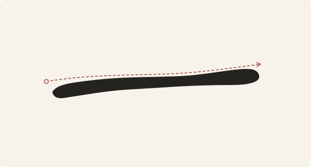
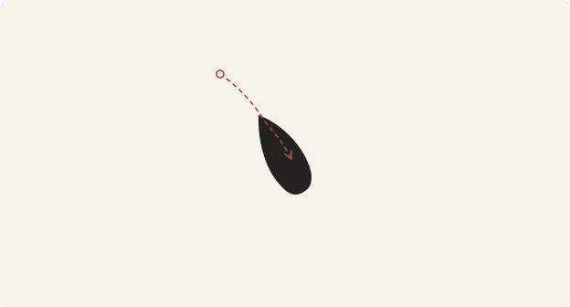
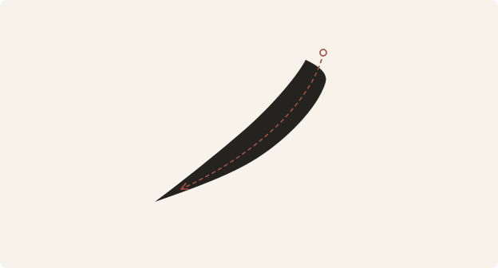
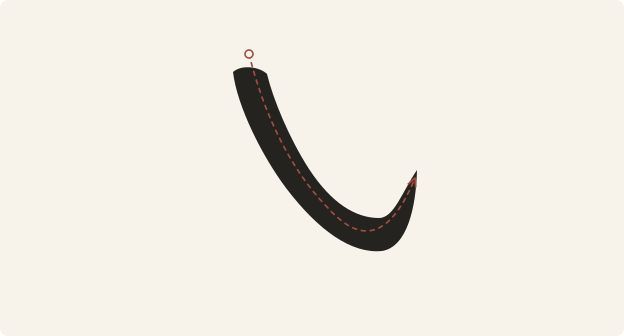
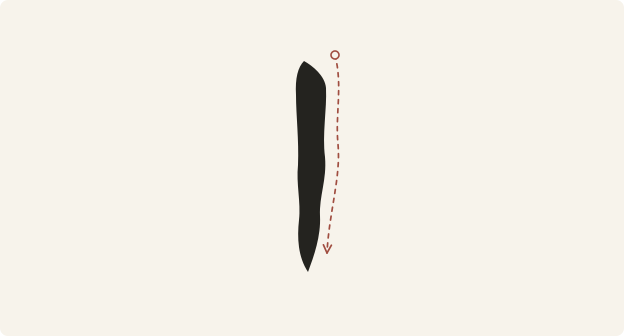
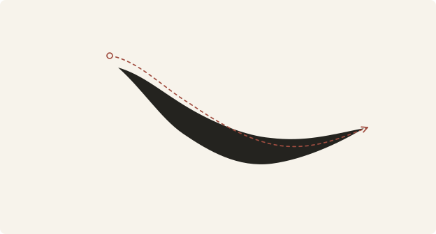
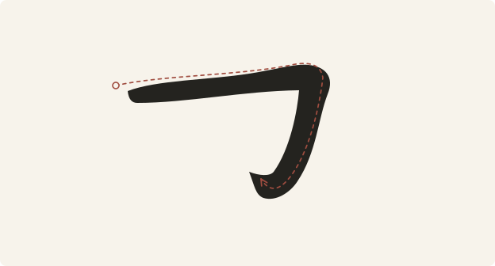

# 일곱 획을 붓으로 읽기

한 번 숨을 고르고, 아직 비어 있는 종이에서 획이 시작할 자리와 끝날 자리를 본다. 《필진도》는 ‘그림을 닮은 선’을 공들여 그리는 법을 설명하기보다, 사물의 모습을 통해 획이 생겨나는 힘을 느끼게 한다. 무거운 돌은 어떻게 짧게 내려앉는가. 가벼운 구름은 어떻게 멀리 펼쳐지면서도 형체를 잃지 않는가.

아래 그림의 검은 면은 연습에서 나올 수 있는 획을 한 가지씩 그린 것이다. 붉은 선은 생각해 볼 붓길이며, 동그라미에서 화살표로 움직인다. 실제 붓털은 눌리고 펴지고 돌아오며 종이 위에서 차지하는 자리가 달라진다. 도해와 연습 동작은 이 판의 실습 제안이다. [고판본의 획표와 번역](bizhentu.md#w06--일곱-획)

예시 글자는 한자 해서로 쓴다. 각 실습의 첫 그림은 당나라 안진경의 〈다보탑비〉 명대 탁본에서 글자 한 자를 잘라 온 것이다. 갈고리 실습은 체본의 我에서 비스듬한 갈고리를 살피고, 그 움직임을 弋에 옮겨 본다. 탁본에서 글자 전체의 짜임과 획 사이 여백을 보고, ‘붓길 도해’를 열어 한 획에서 살필 동작을 확인한다. [〈다보탑비〉 소장 기록](https://digitalarchive.npm.gov.tw/Collection/Detail/33063?dep=P) · [서체와 획 이름](writing-style.md)

점 실습에서는 같은 主의 윗점을 떼어 본 모습도 함께 놓았다. 점 하나에서 닿는 무게를 살피고, 글자 전체에서 그 점이 첫 가로획과 이루는 방향과 간격을 본다.

실습은 명대 《진체비서》본에 보이는 획표 순서를 따른다. 장쉰의 책과 다시 만날 때는 [장쉰 3장 독서 길잡이](chang.md)에서 차례를 견줄 수 있다.

한 획을 두 번 쓰고 두 글씨를 곁에 놓는다. 종이에 닿고 떠나는 순간에서 변화가 보이기 시작하면, 그 변화가 글자 안의 여백과 다음 획에 어떻게 이어지는지도 살핀다. 여러 번 돌아오는 날에는 즐겨 쓰는 글자나 임서하는 글줄에서 같은 질문을 이어 간다.

## 1 · 멀리 늘어선 구름

> 如千里陣雲，隱隱然，其實有形。

멀리서 본 구름은 윤곽이 옅어도 덩어리가 이어지는 방향이 보인다. 획을 길게 보내는 동안에도 그 길을 잃지 않는 감각부터 익힌다.

- 一을 한 번 쓴다. 다음에는 같은 길이로 두되, 팔을 오른쪽으로 고르게 보내면서 중간에 붓털이 조금 가벼워지도록 해 본다. 시작과 끝에서 먹이 고이는 정도를 비교한다.
- 三을 두 번 쓴다. 두 번째에는 맨 아래 획의 길이만 조금 바꾸고, 위 두 획의 위치는 가능한 한 그대로 둔다. 아래쪽에 생긴 흰 면과 글자 전체가 디디고 있는 자리를 함께 본다. 같은 三을 글줄 속에 써서, 아래 획의 길이가 다음 글자로 시선을 보내는 방식도 살핀다.

[《필진도》의 일곱 획](bizhentu.md#w06--일곱-획) · [《제후》의 산가지 비유](postface.md#h02--뜻이-붓보다-먼저-간다)

## 2 · 떨어지는 돌

> 如高峰墜石，磕磕然，實如崩也。

떨어진 돌은 매우 짧은 순간에 무게를 전한다. 점도 작게 보이지만 펼쳐지고 거두어지는 시간이 있다. 종이 위의 점이 한 번 닿아 생겼는지, 여러 번 덧대어 커졌는지는 가장자리와 먹의 고임에서 드러난다.

- 비어 있는 종이에 점 하나가 놓일 자리를 본다. 붓이 어느 방향으로 내려올지 정하고, 붓털이 살짝 벌어질 만큼 눌렀다가 한 번에 거둔다.
- 같은 먹으로 느긋한 착지와 짧고 또렷한 착지를 번갈아 쓴다. 종이에 닿기 시작한 자리와 힘이 모인 자리가 보이는가. 점의 가장 무거운 쪽이 아래 획으로 시선을 보내는가.
- 점의 크기를 비슷하게 두고 닿는 방향만 바꾸어 主를 다시 쓴다. 닿는 순간이 짧아도 다음 가로획까지 그 방향이 이어지는지 두 글자를 놓고 본다.

[《필진도》의 일곱 획](bizhentu.md#w06--일곱-획) · [《제후》의 송익 이야기](postface.md#h03--송익이-획을-바꾸다)

## 3 · 막힘을 끊고 나아가는 삐침

> 陸斷犀象。

장협의 〈칠명〉에도 이 말이 나온다. 이름난 검의 예리함을 말하는 자리다. 붓으로는 한 번 방향을 정한 뒤 주저 없이 진행하면서, 끝까지 방향이 남는 느낌을 시험할 수 있다.

- 人의 왼삐침을 연습한다. 위쪽에 붓털을 모아 두었다가 왼쪽 아래로 보내고, 뻗는 동안 조금씩 들어 올린다.
- 같은 길이로 두 번 더 쓴다. 첫 획은 일찍 들어 올리고, 두 번째는 중반까지 먹과 무게를 실은 다음 가볍게 마무리한다. 어느 쪽이 끝까지 방향을 유지하는가. 두 방식으로 人을 써서 왼삐침의 끝과 오른쪽 획이 벌려 놓는 흰 면을 비교한다.

[어구의 고전 용례](bizhentu.md#w06--일곱-획)

## 4 · 팽팽함에서 놓임으로

> 百鈞弩發。

‘발(發)’은 힘이 풀리는 순간을 잡아낸다. 그 순간이 느껴지려면 앞의 굽은 길에서 힘이 모이는 시간이 필요하다.

- 弋의 굽은 획을 써 본다. 비스듬히 진행하다 아래에서 잠시 붓털을 모아, 작은 방향 전환 뒤 끝을 가볍게 들어 올린다.
- 갈고리의 크기를 비슷하게 두고, 한 번은 일찍 들어 올리고 한 번은 끝에서 모았다 풀어 준다. 갈고리와 몸통이 한 번의 움직임으로 읽히는가. 두 방식으로 弋을 써서 몸통을 스치는 가로획과 가장 긴장이 모이는 곳을 살핀다.

[《필진도》의 일곱 획](bizhentu.md#w06--일곱-획) · [《제후》의 戈](postface.md#h03--송익이-획을-바꾸다)

## 5 · 오래 마른 덩굴

> 萬歲枯藤。

말라 있는 덩굴에는 자라 오르던 때의 결이 남는다. 세로획의 윤곽이 조금 울퉁불퉁해도 위에서 아래로 향하는 줄기는 단단히 느껴질 수 있다.

- 세로획을 크게 긋는다. 평소보다 붓을 조금 느리게 보내며, 중간에 손가락만 조여 고치기 쉬운 자리를 느껴 본다. 그다음 획에서는 움직이는 팔의 흐름을 따라 붓털이 펴지게 둔다.
- 中을 써서 중심 세로획의 양옆에 남은 흰 면을 본다. 이번에는 자리를 그대로 두고 세로획의 굵기를 조금 다르게 쓴다. 아래까지 같은 방향이 느껴지는가. 굵기가 달라지자 글자가 어느 쪽으로 기운 듯 보이는가.

[《필진도》의 뼈와 힘줄](bizhentu.md#w05--뼈와-살과-힘줄)

## 6 · 무너지는 파도, 내달리는 우레

> 崩浪雷奔。

파도는 몸이 한 번 불어나 무너지고, 우레는 그 뒤로 멀리 내달리는 듯하다. 이 획에는 무게가 커지는 자리와 줄어드는 자리가 모두 있다.

- 人의 오른쪽 파임으로 시작한다. 오른쪽 아래로 진행하며 서서히 눌렀다가, 가장 넓은 곳을 지나며 오른쪽으로 조금씩 들어 보낸다.
- 같은 원리로 近의 책받침 마지막 획을 써 본다. 글자를 두 번 쓰면서 파임의 가장 무거운 자리만 조금 옮긴다. 어느 쪽이 위의 斤을 단단히 받치고, 어느 쪽에서 빈 공간이 열리며 시선이 멀리 나아가는가.

[《필진도》의 일곱 획](bizhentu.md#w06--일곱-획) · [《제후》의 파획](postface.md#h05--돌에-부딪는-파획과-매의-꼬리)

## 7 · 꺾인 자리의 마디

> 勁弩筋節。

여기서는 같은 쇠뇌에서 마디와 힘줄을 본다. 꺾이는 곳에서는 방향이 바뀌고, 그 전후의 힘이 서로 이어져야 한다. 붓털이 잠깐 모여드는 자리를 느껴 본다.

- 力의 첫 획을 크게 써서 가로로 진행한 뒤, 살짝 들며 방향을 바꾸어 아래로 내려온다. 끝에서 짧게 거둔다.
- 꺾이는 곳을 크게 눌러 쓴 획과, 전환하기 전에 무게를 잠깐 덜어 낸 획을 나란히 둔다. 방향을 바꾼 뒤에도 탄력이 이어지는 곳을 찾는다. 두 방식으로 力을 써서 꺾인 획과 왼삐침이 사이에 남기는 흰 면이 어떻게 열리고 닫히는지 살핀다.

[《필진도》의 일곱 획](bizhentu.md#w06--일곱-획)

## 글자 안에서 다시 만나기

한 번에 한 가지를 바꾼다. 같은 종이와 붓으로 쓰면 손의 변화가 글씨에 어떤 차이를 남겼는지 알아보기 쉽다. 눈에 들어오는 차이를 한 줄 적고, 다음에 그 한 줄을 갖고 돌아온다.

1. 한 구절을 천천히 읽는다. 눈을 들어 사물을 떠올리고 획의 시작, 무거워지는 곳, 끝을 종이 위에 미리 본다.
2. 한 획을 익숙한 손으로 한 번, 의식적으로 한 가지를 바꾸어 두 번 더 쓴다. 바꿀 것은 속도, 눌렀다 들어 올리는 폭, 방향 전환의 시점 가운데 하나면 된다.
3. 해당 획이 든 글자를 두 번 쓴다. 이번에는 옆 획 사이에 남은 희고 빈 부분을 함께 보며 쓴다. **계백당흑**(計白當黑)은 이 실습에서 여백을 획만큼 의식하는 편집과 연습의 기준이다.
4. 종이를 잠깐 내려놓았다가 돌아와 본다. ‘아름답다’라는 평 대신 ‘어디서 먹이 고였는지’, ‘눈이 다음 획으로 옮아갔는지’, ‘뜻보다 손이 먼저 간 자리가 어디인지’를 한 줄 적는다. 다음에 같은 글자를 써서 그 한 줄이 달라지는지 본다.

예를 들어 첫날의 기록이 ‘中의 세로에서 붓을 거두기 전에 손이 먼저 아래로 꺾였다’라면, 다음날은 마지막 3분의 1에서 손의 방향만 지켜 본다. 활발하게 크게 쓴 획을 익힌 뒤 작은 글자에 옮겨 보면, 줄어드는 크기 속에서도 남겨 둘 움직임이 뚜렷해진다.

### 오늘의 한 획을 내일의 글씨로

한 가지 감각을 익힌 뒤 옛 글씨의 두세 글자를 곁에 놓는다. 예를 들어 〈봉귤첩〉에서 글자마다 크기와 기울기가 달라지는 곳을 골라, 나도 그 변화가 어디에서 시작하는지 느끼며 써 본다. 다음에는 같은 느낌을 내가 쓰고 싶은 글자와 문장에 옮긴다. 며칠 뒤 처음 쓴 종이와 나란히 놓고, 마음속에 먼저 그릴 수 있게 된 것이 무엇인지 살핀다. 다시 《필진도》를 읽으면 전에 눈에 머물지 않았던 말이 보일 수 있다. [붓을 들고 볼 왕희지의 글씨](history.md#붓을-들고-볼-세-작품)
