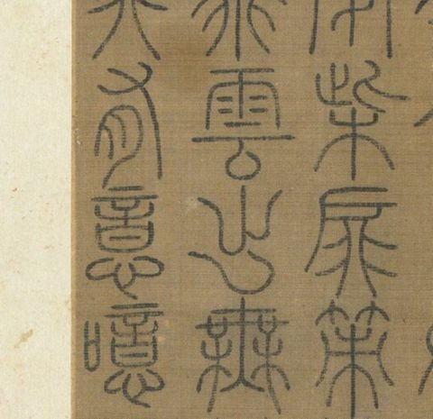
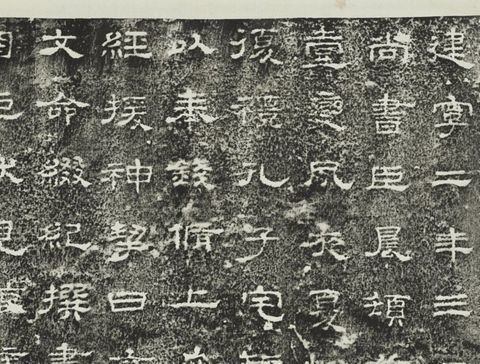

# 《필진도》를 읽다가 궁금한 말

고전의 말이 가리키는 사람, 사물, 움직임을 오늘의 독자가 떠올려 볼 수 있게 풀었다. ‘써 보면’은 이 사이트의 연습 제안이다.

## W01 · 세 가지 끝, 육예, 글씨를 본 사람들

### 세 가지 ‘끝’이 뭐예요?

글을 짓는 사람의 **붓끝**, 싸우는 사람의 **칼끝**, 말로 설득하는 사람의 **혀끝**이다. 글을 남기고, 칼을 휘두르고, 말로 마음을 움직이는 힘이 각각 그 끝에서 나온다는 옛 비유다. 《필진도》는 그중 붓끝이 부리는 묘함에서 이야기를 시작한다. [삼단의 옛 용례를 모은 《어정병자유편》](https://zh.wikisource.org/wiki/御定駢字類編_(四庫全書本)/全覽4)

### 육예는 무엇이고, 은빛 갈고리는 왜 나와요?

육예(六藝)는 《주례》에서 가르친 여섯 가지 기예다. **예절, 음악, 활쏘기, 수레 몰기, 글자 익히기, 셈하기**다. 옛 문헌에서는 여섯 경전을 가리키기도 한다. 여기서는 글씨와 이어지는 첫째 뜻으로 읽었다. ‘은빛 갈고리’는 금속으로 된 작은 갈고리를 눈앞에 떠올리게 하는 필획의 비유다. 가는 선에도 단단히 버티고 방향을 바꾸는 힘이 느껴질 수 있다. [《주례》 〈보씨〉](https://ctext.org/wiki.pl?chapter=866142&if=gb)

### 이사와 주 목왕은 누구예요?

**이사**(李斯)는 진시황 때 천하 통일에 관여하고 승상까지 오른 사람이다. 승상은 임금을 보좌하며 나라의 정무를 맡은 높은 벼슬이다. 진이 글자 모양을 통일하는 과정에서도 이사의 이름이 나온다. **주 목왕**(周穆王)은 그보다 여러 세기 앞선 서주의 왕이다. 어떤 글씨를 보고 누가 뼈대가 없다고 느꼈는지는 이 구절만으로 확정하기 어렵다. 서예에 이름난 이사조차 옛 글씨 앞에 오래 머물고 힘의 유무를 생각했다는 이야기로 읽을 수 있다. [《사기》 〈이사열전〉](https://zh.wikisource.org/wiki/史記/卷087) · [《사기》 〈주본기〉](https://ctext.org/shiji/zhou-ben-ji)

### 채옹은 누구예요? 홍도와 비갈은 뭐예요?

**채옹**(蔡邕)은 후한 말의 학자이자 문인으로, 경전의 글자를 바로잡아 돌에 새긴 **희평석경** 사업에 참여했다. ‘상서’는 조정의 문서와 정무를 다루던 벼슬 이름이고, 여기서는 글이 채옹을 그렇게 부른다. **홍도**(鴻都)는 후한 수도 낙양 궁궐의 홍도문과 그 일대를 가리키는 말로 읽힌다. 오늘날의 도시 이름처럼 읽으면 장소를 그리기 어렵다. **비갈**(碑碣)은 글자를 새겨 세워 둔 비석을 가리킨다. 여기 나온 그 비석의 이름은 전해지지 않는다. 《후한서》가 희평석경을 세웠다고 기록한 곳은 태학이다. [《후한서》 〈채옹전〉](https://ancient-china-books.github.io/houhanshu/OEBPS/Text/060b.htm) · [대만 교육부 〈홍도문학〉](https://pedia.cloud.edu.tw/Entry/Detail?title=%E9%B4%BB%E9%83%BD%E9%96%80%E5%AD%B8)

## W02 · 이사의 붓 쓰는 법은 어디에 남았을까?

《필진도》는 ‘이사의 붓 쓰는 묘법’을 덜어 내고 다듬었다고 말한다. 책 제목이나 전해 받은 경로는 밝히지 않는다. **이사의 이름으로 전하는 〈용필법〉은 있다.** 송대의 《묵지편》과 《서원청화》(書苑菁華) 같은 서예 문헌에서 읽을 수 있다. 남은 자료로는 진나라 이사가 직접 썼는지, 이 글이 《필진도》의 바탕이었는지, 글로 전해지기 전에 입으로 전했는지 확인하기 어렵다. [《묵지편》 영인](https://upload.wikimedia.org/wikipedia/commons/1/10/Shanghai_%E5%A2%A8%E6%B1%A0%E7%B7%A8%E5%85%AD%E5%8D%B7.pdf) · [《서원청화》 권1](https://ctext.org/wiki.pl?chapter=6515373&if=gb)

그 전칭 글은 붓을 재빨리 돌리고 내려 보내는 동작, 자연스럽게 이어져 덧손질을 줄이는 동작을 말한다. 물을 만난 물고기와 산에서 피어나는 구름을 떠올리며, 붓이 오므라들고 펴지고 가벼워졌다 무거워지는 변화를 살피라고 한다. 두 글을 함께 읽을 때는 **사물에서 붓의 움직임을 배운다는 공통점**을 먼저 느껴 볼 수 있다. [이사 전칭 〈용필법〉](https://zh.wikisource.org/zh-hant/用筆法_(李斯))

## W03 · 한 치, 여산과 대군, 아교와 어란지

### 한 치는 몇 cm예요?

한 치(寸)는 **한 자(尺)의 10분의 1**, 한 푼(分)은 한 치의 10분의 1이다. 중국국가박물관의 비교치에 따라 동진 무렵의 자를 약 24~25cm로 두면, **한 치는 약 2.4~2.5cm**, 다섯 치는 **약 12~12.5cm**다. 길이 감을 얻기 위한 예시다. 한 시대에도 자의 기준은 달랐고, 이 글이 어느 자를 썼는지는 밝혀져 있지 않다. [중국국가박물관 〈청동 자〉](https://www.chnmuseum.cn/zp/zpml/csp/202008/t20200826_247437.shtml) · [《수서》 〈율력지〉](https://zh.wikisource.org/zh-hant/隋書/卷16)

### 여산과 대군은 어디예요? 사슴 아교는 뭐예요?

**여산**(廬山)은 지금 중국 장시성 북쪽의 산이다. 소나무 그을음은 소나무를 태울 때 나오는 검은 그을음을 모은 것이다. **대군**(代郡)은 오늘날의 산시성 북동부와 허베이성 서북부 일대에 있던 옛 행정구역이다. 경계는 시대마다 달랐다. 글은 검은 안료와 그것을 굳히는 재료를 각각 어디에서 얻는지 짚는다. [유네스코 〈루산〉](https://whc.unesco.org/en/list/778/) · [《한서》 〈지리지〉 원문과 주석](https://www.wenlinshe.com/tw/chapter/zhuzibaijia/han-shu/han-shu-xin-zhu-juan-er-shi-ba-xia-di-li-zhi-di-ba-xia.html) · [한국민족문화대백과 〈먹〉](https://encykorea.aks.ac.kr/Article/E0018103)

**아교**는 동물의 가죽·뼈·힘줄 등에 있는 콜라겐 성분을 뜨거운 물로 우려 내고, 건더기를 걸러 말려 얻는 접착 재료다. 먹에 섞으면 흩어지기 쉬운 그을음 입자를 붙들어 막대 모양으로 굳게 해 준다. ‘녹교(鹿膠)’는 사슴에서 얻었다는 뜻까지 전한다. 이 문장에는 사슴의 어느 부위를 썼는지 적혀 있지 않다. [보스턴미술관 보존재료 사전 〈동물 아교〉](https://cameo.mfa.org/wiki/Animal_glue) · [《천공개물》 〈먹〉](https://zh.wikisource.org/wiki/天工開物/墨)

### 어란지는 물고기 알로 만든 종이예요? 한지와 비슷해요?

**어란지**(魚卵紙)는 물고기 알을 뜻하는 글자가 들어간 옛 종이 이름이다. 《필진도》는 동양(東陽)에서 나는 가볍고 부드럽고 매끈한 종이라고 묘사한다. 송대 《문방사보》에도 종이 이야기로 인용되지만, 이 대목들로 정확한 섬유나 제조법을 정할 수 없다. 물고기 알의 겉모양에서 이름이 왔다는 풀이가 있다. 한국의 전통 한지는 주로 닥나무 껍질의 섬유로 뜬다. 두 종이의 재료를 같다고 볼 근거는 없지만, **부드러운 정도와 붓이 미끄러지는 정도**는 손에 든 종이를 바꿔 가며 직접 비교할 수 있다. [《문방사보》 권4](https://www.shidianguji.com/zh/book/SK1709/chapter/1jurwd7qtvub6) · [프랑스 국립도서관의 해설](https://cdn.essentiels.bnf.fr/uploads/media/attachment/20221124085247000000_calligraphie.pdf) · [한국민족문화대백과 〈한지〉](https://encykorea.aks.ac.kr/Article/E0061987)

## W04 · 왜 처음에는 크게 써요?

본문은 붓을 온몸으로 보낸다는 말 바로 뒤에 큰 글씨부터 쓰라고 한다. 그 이유를 따로 밝히지는 않는다. 크게 쓰면 한 획을 보내는 길이 길어져, 팔이 움직일 때 **붓털이 언제 눌리고 어디서 다시 모이는지** 보기 쉽다. 작은 글씨에서는 짧은 시간에 일어나는 일이다. 여기서 ‘온몸의 힘’은 어깨와 손목에 힘을 더 주라는 뜻으로 읽을 필요가 없다. 붓이 가는 방향을 몸이 끝까지 함께 보내는 느낌을 살펴볼 수 있다.

**써 보면** · 같은 ‘中’을 손바닥만 하게 한 번, 평소 글씨 크기로 한 번 쓴다. 가운데 세로에서 붓털이 가장 넓어지는 지점이 크기에 따라 어떻게 달라지는지 본다.

## W05 · 잘 보는 것과 잘 쓰는 것, 뼈와 살

### 왜 잘 보는 사람은 잘 쓰지 못한다고 해요?

글씨를 보고 어디에 힘이 있는지 알아채는 눈과, 붓을 들어 그 힘을 남기는 손은 서로 다른 경험으로 자란다. 《필진도》는 두 힘이 저절로 함께 따라오지 않는다는 점을 아주 강한 문장으로 보여 준다. 한 사람이 둘 다 익힐 수 있다. 체본에서 좋아 보이는 한 곳을 찾고, 직접 써 본 뒤 처음 보았을 때는 놓친 차이를 다시 찾으면 두 능력이 서로를 돕는다.

### 획에 어떻게 뼈와 살이 있어요?

**뼈**는 굵기와 별개로 한 획의 방향과 글자의 짜임을 버티는 힘이다. **살**은 먹이 종이에서 차지하는 너비와 볼륨이다. **힘줄**은 시작과 끝, 혹은 방향을 바꾸기 전과 후가 늘어지지 않고 이어지는 긴장에 빗댄 말이다. 두껍게 쓴 획에도 단단한 방향이 남을 수 있고, 가늘게 쓴 획도 힘없이 보일 수 있다. 두 획을 곁에 놓고 ‘어느 게 굵지?’에 이어 ‘어느 쪽이 끝까지 같은 방향으로 나아가지?’라고 물어 본다.

## W06-horizontal · 구름이 어떻게 진을 칠까?

**진**(陣)은 여러 사람이 한 방향과 자리를 맞추어 이룬 대열이다. 해 질 무렵 산 너머에 낮은 구름이 여러 겹 길게 늘어선 모습을 생각해 보자. 가장자리는 흐려도 구름 덩어리들이 같은 쪽으로 뻗어 있어 하늘에서 한 줄기의 방향이 읽힌다. ‘천 리’는 그만큼 넓게 펼쳐짐을 느끼게 한다.

**써 보면** · 가로획 가운데가 살짝 가벼워져도 시작에서 끝까지 같은 쪽으로 이어지는지 본다.

## W06-dot · 작은 돌일까, 큰 바위일까?

원문에는 돌의 크기가 없다. 높은 자리에서 내려와 **쿵 하고 한곳에 무게가 실리는 순간**이 또렷하다. 점이 작아도 붓털이 종이에 닿고 눌렸다 거두어지는 짧은 시간은 느낄 수 있다.

**써 보면** · 점 하나를 떨어뜨리듯 쓰고, 그다음 같은 크기로 천천히 눌러 쓴다. 어느 점에서 무게가 모이는 자리가 더 분명한지 본다.

## W06-left-falling · 코뿔소와 코끼리를 벤다는 느낌

이 말은 서진 장협의 〈칠명〉에서도 이름난 칼의 예리함을 나타낸다. 코뿔소와 코끼리를 한꺼번에 떠올릴 만큼 큰 저항을 이겨 내는 이미지다. 삐침에서는 위에서 정한 방향을 따라 **왼쪽 아래로 한 번에 나아가는 결단**으로 옮겨 읽을 수 있다.

**써 보면** · ‘人’의 왼획을 점점 가늘게 빼면서, 맨 끝에서도 향하는 곳이 분명한지 본다. [《문선》 장협 〈칠명〉 영인](https://upload.wikimedia.org/wikipedia/commons/2/2f/SSID-10513789_%E7%AD%86%E9%81%B8_7.pdf)

## W06-slant-hook · 백 균의 쇠뇌가 놓인다는 말

**균**(鈞)은 무게 단위로 《설문해자》에서는 30근이다. 그러므로 백 균은 옛 단위로 3,000근이다. 근의 크기는 시대마다 달랐고, 이 비유에서는 **엄청난 힘을 품었다가 놓는 느낌**을 헤아리는 것이 중요하다. 쇠뇌는 활이 긴 몸체에 가로로 놓이고, 당겨진 줄을 붙들 수 있게 만든 옛 활이다.

**써 보면** · ‘弋’에서 붓털이 비스듬히 내려오며 살짝 모이게 하고, 마지막에 짧게 들어 본다. 끝의 움직임이 그 앞에서 이어져 나온 듯 보이는가. [《설문해자》 〈근부〉](https://ctext.org/shuo-wen-jie-zi/jin-bu4/zh) · [메트로폴리탄미술관의 한대 쇠뇌 유물](https://www.metmuseum.org/art/collection/search/61048)

## W06-vertical · 만 년 된 덩굴은 왜 세로획일까?

‘만 년’은 실제 나이보다 **아주 오래 묵은 느낌**을 전하는 말이다. 겨울에 잎이 떨어진 덩굴이 담을 타고 길게 내려온 모습을 떠올려 보자. 마르고 굽은 부분 사이로도 하나의 줄기가 눈에 이어진다. 세로획은 곧게 서면서도 그 안에 그런 긴장을 품을 수 있다.

**써 보면** · ‘中’의 가운데 세로를 쓸 때 위에서 아래로 어디까지 방향이 이어지는지 본다. 덩굴의 울퉁불퉁한 윤곽을 일부러 그릴 필요는 없다.

## W06-right-falling · 우레는 어떻게 내달릴까?

파도는 한곳에 무게가 쌓였다가 무너진다. 천둥은 쿵 하고 터지는 순간 뒤에 울림이 멀리 건너가는 것처럼 들린다. 글은 두 장면을 붙여 **무게가 한곳에 모였다가 멀리 풀리는 움직임**을 느끼게 한다.

**써 보면** · ‘近’의 마지막 획에서 붓털이 가장 넓게 펴진 곳을 지나, 오른쪽으로 얼마 동안 흐르다가 끝나는지 살핀다.

## W06-turning-hook · 쇠뇌의 어느 부분에 마디가 있을까?

쇠뇌의 몸체 위에는 가로로 놓인 활몸과 시위가 있다. 원문의 ‘힘줄과 마디’가 어느 부품의 이름인지는 알 수 없다. 팽팽히 버티는 부분과 힘이 꺾여 이어지는 자리를 함께 떠올려 볼 수 있다. 앞의 ‘쇠뇌가 놓인다’가 **힘이 풀리는 순간**에 귀를 기울인다면, 여기서는 **꺾이기 전과 후에도 힘이 이어지는 자리**를 본다.

**써 보면** · ‘力’의 첫 획을 두 번 쓴다. 꺾는 곳에서 한 번은 잠깐 멈추고, 한 번은 붓털의 눌림을 조금 덜어 방향을 바꾼다. 어느 쪽에서 가로와 세로가 한 획으로 이어져 보이는지 본다. [타이베이 국립고궁박물원의 쇠뇌 유물 해설](https://www.npm.edu.tw/NewChineseArtDownload.ashx?bid=4523)

## W07 · ‘붓의 진’은 어떤 모습일까?

‘진’은 여러 움직임을 엮어 전체의 형세를 만드는 진형이다. 이 글은 붓이 종이에 **들어오고 빠져나오고, 방향을 자르고 짧게 내리꽂는** 움직임에 전장의 말을 빌렸다. 운동장에서 짧게 멈췄다가 몸을 돌리는 장면처럼 생각해도 좋다. 발을 아무 데나 디디면 다음 동작이 늦고, 갈 곳을 미리 보았다면 몸이 그쪽으로 이어진다. ‘뜻이 먼저 간다’는 말은 붓이 종이에 닿기 전에 글자가 놓일 자리와 움직일 방향을 마음으로 먼저 보는 데서 시작한다. [《제위부인필진도후》의 종이와 진](postface.md#h01--종이에-진을-치다)

## W08 · 전서, 장초, 팔분, 비백, 학두, 옛 예서

글은 여섯 이름 앞에 모두 ‘**~같다**’를 붙였다. 글씨마다 힘이 나타나는 방식이 다르다는 뜻으로 읽을 수 있다. 아래 예시 작품은 눈으로 비교해 보기 위해 골랐다.

### 전서(篆書) · 돌아도 끊기지 않는 붓길

옛 한자 서체의 한 계열이다. 소전(小篆)의 고른 굵기와 길게 돌아 나가는 선을 보면 ‘둥글고 온전하다’는 말을 떠올리기 쉽다. 원필(圓筆)은 획을 시작하거나 방향을 바꿀 때 붓으로 둥근 맛을 내는 방식이다. 아래 사진 가운데 줄에서 작게 돌고 다시 올라오는 선을 눈으로 따라가 보자.

송나라 상표의 전서 일부. [타이베이 국립고궁박물원 〈전서로 쓴 송나라 사람의 사〉](https://digitalarchive.npm.gov.tw/Collection/Detail/14361?dep=P) · [CC BY 4.0](https://creativecommons.org/licenses/by/4.0/deed.ko)

**써 보면** · 붓을 똑바로 세워 비슷한 굵기로 천천히 한 번 돌아 본다. 손이 꺾이는 순간에 선이 갑자기 가늘어지거나 먹이 한곳에 고이는지 본다.

### 장초(章草) · 가볍게 날아도 글자가 선다

초서의 이른 형식이다. 글자 안의 획이 줄거나 이어지고 예서의 길게 빠지는 끝이 남은 예가 많다. 글자 사이가 하나씩 떨어져 있어도 각 글자의 끝을 따라 시선이 다음 글자로 가는 리듬이 있다. ‘걸림 없이 풀어진다’는 말은 그 가벼운 진행을 느끼게 한다. [타이베이 국립고궁박물원 왕주 임서 〈급취장〉](https://digitalarchive.npm.gov.tw/Collection/Detail/20859?dep=P)

### 팔분(八分) · 끝이 멀리 벌어지는 기세

시대마다 쓰임이 달랐던 이름이다. 여기서는 한대 비석의 예서에서 볼 수 있는, 가로획 끝을 들어 **좌우로 자리를 크게 쓰는** 모습에서 실마리를 얻을 수 있다. 획 끝에 무게가 잠깐 실린 뒤 위로 벗어나, 글자가 펼쳐지는 듯 긴장감이 생긴다. ‘아슬아슬하고 위압적’이라는 말은 그 기세에 붙인 표현이다. 아래 사진에서 가로획 오른쪽이 넓어졌다가 살며시 들리는 곳을 찾아 본다.

후한 〈사신전비〉 탁본 일부. [타이베이 국립고궁박물원 소장 기록](https://digitalarchive.npm.gov.tw/Collection/Detail/14968?dep=P) · [CC BY 4.0](https://creativecommons.org/licenses/by/4.0/deed.ko)

### 비백(飛白) · 획 안에서 보이는 종이빛

한 획 안에 붓털이 스치고 지나가며 흰 결이 드러나는 옛 글씨 방식이다. 마른 붓이 종이를 쓸 때 먹이 닿은 실과 닿지 않은 실이 함께 남는 장면을 상상할 수 있다. 흰 결을 따라가면 붓이 어느 방향으로 들어오고 나갔는지 보인다. 옛 비백에는 별도의 서체 전승도 있다. [《법서요록》 〈벽서 비백 ‘소’ 자기〉](https://ctext.org/wiki.pl?chapter=978026&if=en)

### 학두(鶴頭) · 꼿꼿하게 홀로 서는 기분

글자 그대로 ‘학의 머리’라는 이름의 옛 글씨다. 이 문장에는 글자의 모양이나 붓길이 남아 있지 않아 하나의 모습으로 그리기 어렵다. 이 대목에서는 ‘**꼿꼿이 홀로 선다**’는 설명을 붙잡고 읽을 수 있다. 반듯하게 선 새의 목을 떠올리며, 글자 하나가 주변 여백에 기대지 않고 어느 방향으로 서 있는지 본다. [《패사휘편》의 〈학두서〉 기록](https://ctext.org/wiki.pl?chapter=7443396&if=gb)

### 옛 예서(古隸) · 가로와 세로로 힘을 펼친다

예서(隸書)는 전서에서 벗어나 획과 짜임이 펼쳐진 옛 글씨 계열이다. 한대 비석의 낮고 넓은 글씨와 그보다 이른 진나라 죽간의 글씨를 나란히 보면 옛 예서 계열에서도 글자의 모양이 여러 가지였음을 느낄 수 있다. ‘고예’의 범위는 옛 글마다 다르며, 이 대목에서 앞의 팔분과 어떤 작품을 두고 나눈 것인지는 확정하기 어렵다. **써 보면** · 글자 안에 길게 누운 획과 바로 선 획을 놓고, 두 방향이 이루는 여백을 살핀다. [후베이성박물관의 수호지 진간 전시](https://www.hbww.org.cn/xwdt/p/9799.html)
